<div align="center">
  <a href="https://github.com/0xMask3d">
    
  </a>
</div>

<p align="center">
  
  
  
</p>

```bash
mask3d@github:~$ neofetch --profile
--------------------------------------------------
ALIAS      : Mask3d
ROLE       : Open-Source Contributor & Android Tinkerer
STACK      : Kotlin · Android SDK · Android Auto · ADB · Shell
MODDING    : Media clients, TV/Android debloating, custom launchers
OPS        : Feature engineering, log diagnostics, FOSS bug hunting
MINDSET    : Read the source. Patch the flaw. Ship the fix.
```

---

### `> ls -la ./highlighted_ops`

| Target | Operation | Impact |
| :--- | :--- | :--- |
| **[OreoMuncher45/Auris](https://github.com/OreoMuncher45/Auris/pulls?q=author%3A0xMask3d)** | Engineered Android Auto support (Spotify playlists, Daylist & Home recommendations) | `+3.3k lines` · Kotlin |
| **FOSS Ecosystem** | Deep bug hunting, logcat/diagnostic triage & reproducible regression reports | QA · Debugging |
| **Android Systems** | Firmware debloating, ADB automation & custom launcher deployments | ADB · Shell |

---

### `> cat ./toolkit.txt`

<p align="left">
  
  
  
  
  
</p>

---

### `> ./sys_stats.sh`

<div align="center">
  
</div>

---

<div align="center">
  <picture>
    <source media="(prefers-color-scheme: dark)" srcset="https://raw.githubusercontent.com/0xMask3d/0xMask3d/output/github-contribution-grid-snake-dark.svg" />
    <source media="(prefers-color-scheme: light)" srcset="https://raw.githubusercontent.com/0xMask3d/0xMask3d/output/github-contribution-grid-snake.svg" />
    
  </picture>
</div>
